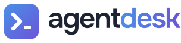

<h4 align="center">
  <picture>
    <source media="(prefers-color-scheme: dark)" srcset="docs/images/wordmark-dark.svg">
    
  </picture>
  <br>
  Run, coordinate, and review coding agents from one browser tab
</h4>

<p align="center">
  <a href="https://github.com/dylan-murray/agent-desk/actions/workflows/checks.yml"></a>
  <a href="pyproject.toml"></a>
  <a href="pyproject.toml"></a>
  <a href="LICENSE"></a>
</p>

<h2></h2>

Agent Desk is a local workspace for coding agents. Run any coding agent side by
side in real terminals, with built-in support for Claude Code, Codex, Grok,
OpenCode, and Pi, and a custom command option for any other agent CLI.
Hand work to a coordinator that splits it across agents, and review what comes
back in one inbox.


## ✨ What you get

- 🖥️ **Terminals** for Claude Code, Codex, Grok, OpenCode, Pi, and more, up to 16 in resizable layouts
- 🗂️ **Desks** that keep separate projects' agents apart, each with its own panes
- 🧭 **Coordinators** that hand work to agents and track what comes back
- 🔀 **Model router** support, so coordinators pick each worker's model and harness per task
- 🗺️ **Agent map** showing which agent launched which
- 📥 **Inbox** for questions, finished work, and scheduled runs
- 📌 **Annotations** you click onto the UI and send to an agent
- 🧩 **Skills** shared across every agent you use

## 🚀 Quick start

The quickest way in is to let your coding agent set it up. Clone the repo, open
it in Claude Code, Codex, or Grok, and say:

> Set up Agent Desk with the skill in `skills/agent-desk-setup`.

The [agent-desk-setup](skills/agent-desk-setup/SKILL.md) skill checks the
prerequisites, starts Agent Desk, and adds your Claude and Codex accounts.

To do it by hand:

```sh
git clone https://github.com/dylan-murray/agent-desk.git
cd agent-desk
python3 -m agent_desk
```

Then open [localhost:4310](http://127.0.0.1:4310). Pass `--port` to use another port.

Requires macOS or Linux, Python 3.11+, Node.js 18+ (22+ to run the test suite), and the agent CLIs you want to use. To install the `agent-desk` command instead, run `pip install .` from the checkout.

Using more than one Claude or Codex login? Add each under **New → Terminal → Accounts**.

Agent Desk only listens on 127.0.0.1. It saves its state in `data/`, or wherever `AGENT_DESK_DATA_DIR` points.

## 📚 Docs

[Guide](docs/guide.md) · [Contributing](CONTRIBUTING.md) · [All docs](INDEX.md)

## 📄 License

[Apache-2.0](LICENSE). Bundled xterm.js and highlight.js keep their own licenses in `agent_desk/static/vendor/`.
