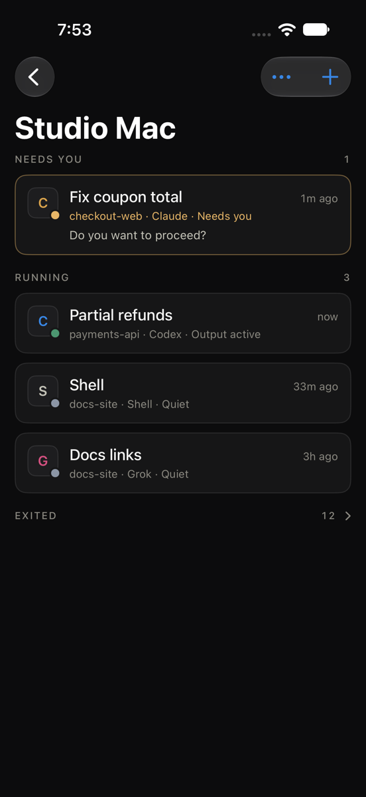
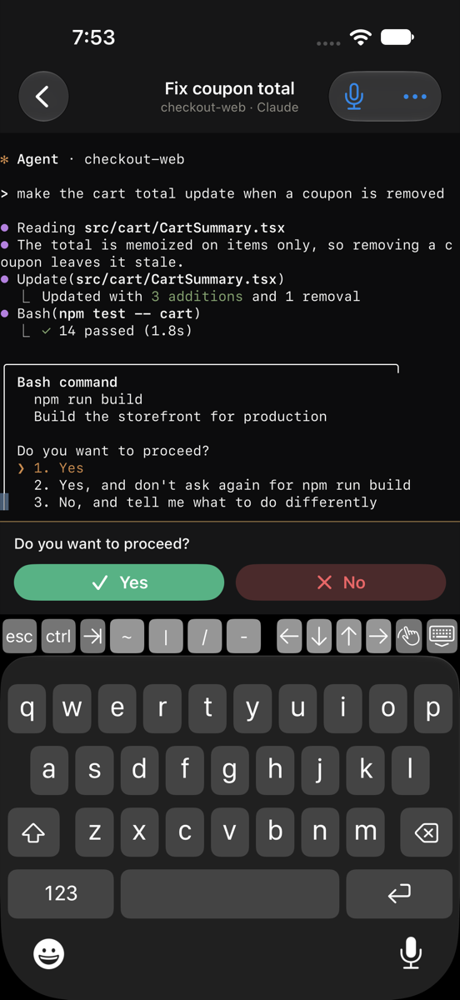
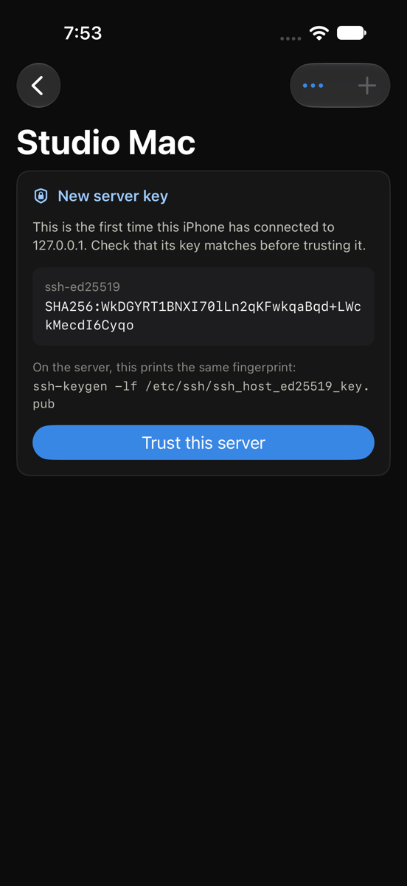
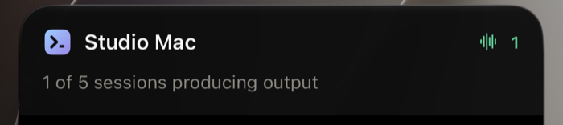

# Agent Desk for iPhone

An iPhone app for the desk running on your Mac or server: see which sessions need you,
answer approval prompts with one tap, type into live terminals, dictate prompts, and launch
agents. A Live Activity keeps the desk's state on the Lock Screen and in the Dynamic Island
while the app is connected.

<p>
  
  
  
</p>
<p></p>

Nothing changes for people who do not use it. The desk still listens only on its loopback
address; the phone reaches it the way you would from a laptop, over SSH.

## How it connects

```
iPhone ──SSH──▶ agent-desk mobile info | watch | launch     (JSON over the SSH login)
       ──SSH──▶ mosh-server new -- agent-desk attach <id>    (starts a terminal server)
       ◀─UDP─▶ mosh-server                                   (the live terminal, over Mosh)
```

- **SSH** signs in with a P-256 key the app creates in the iPhone's Secure Enclave. It never
  leaves the phone, and using it takes Face ID or the passcode once each time the app comes
  to the foreground. The server's host key is pinned the first time you connect, after you
  compare its fingerprint, and a changed key stops the connection.
- **Mosh** carries terminals. It survives switching between Wi-Fi and cellular and the
  phone sleeping, because it is UDP with its own encryption and roaming, not a TCP stream.
  `MoshKit` is a Swift implementation of the Mosh protocol written for this app, so the
  project keeps its Apache-2.0 license (Mosh itself is GPLv3). It does not do Mosh's local
  echo prediction.
- **Protected sessions stay at the desk.** The phone signs in as a local helper, so a session
  locked in its pane header is listed with a lock but cannot be opened from the phone.
- **`agent-desk attach <id>`** joins a desk terminal the same way a browser pane does, so the
  phone and the browser see and type into the same session, and the phone's screen size
  becomes the pane's while the phone is attached. Leaving the terminal on the phone stops
  `mosh-server`; the pane keeps running.

## Set up the machine running the desk

1. Make it reachable over SSH. On a Mac, turn on Remote Login in System Settings → General →
   Sharing. [Tailscale](https://tailscale.com) makes it reachable away from home without
   opening ports. Mosh needs UDP ports 60000-61000 reachable too; Tailscale allows them.
2. Install Mosh: `brew install mosh`, or `apt install mosh`.
3. Make sure `agent-desk` runs in a login shell (`ssh you@mac 'zsh -lc "agent-desk mobile info"'`
   should print JSON while the desk is running). If you run Agent Desk from a checkout,
   reinstall it (`pip install -e .`) so the `agent-desk` command has the `attach` and `mobile`
   subcommands, or set the app's command to `python3 -m agent_desk` for that host.
4. In the app, open **This iPhone's key** and add it to `~/.ssh/authorized_keys` on the machine.

## Build and install

Requirements: Xcode (built and tested with Xcode 27 and iOS 18+ deployment), [XcodeGen](https://github.com/yonaskolb/XcodeGen)
(`brew install xcodegen`), and the Metal toolchain (`xcodebuild -downloadComponent MetalToolchain`)
that SwiftTerm's renderer needs.

```sh
cd ios
cp Signing.xcconfig.example Signing.xcconfig   # your team ID and a bundle ID you own
xcodegen generate
open AgentDesk.xcodeproj
```

Choose your iPhone and run. Xcode asks once to trust SwiftTerm's build plugin, which only
writes SwiftTerm's version into the build. With a free Apple ID, apps installed this way
expire after seven days; a paid developer account lasts a year.

## Tests

```sh
# The Mosh client against RFC 7253 vectors and the real mosh-server, and the SSH client
# against a throwaway OpenSSH server on a loopback port.
cd ios/AgentDeskKit && swift test

# The whole phone path against a running test desk: SSH, agent-desk mobile, launching a
# pane, Mosh to agent-desk attach, approval detection, detaching and reattaching.
AGENT_DESK_E2E_PORT=4377 AGENT_DESK_E2E_COMMAND=agent-desk swift test --filter DeskEndToEndTests
```

The app's own tests run in the Simulator: `AgentDeskTests` checks approval-menu reading and
transcribes recorded speech with the on-device Whisper model (downloading it once), and
`AgentDeskUITests` drives the app through setup, an approval, typing, a launch and the Live
Activity against a fixture desk. The UI test needs a desk and an sshd to talk to, passed in
`TEST_RUNNER_E2E_*` variables: `E2E_SSH_PORT`, `E2E_DESK_PORT`, `E2E_USER`, `E2E_COMMAND`,
`E2E_AUTHORIZED_KEYS` (a file the sshd reads, which the test writes the app's key into),
`E2E_FINGERPRINT` (the sshd's host key fingerprint) and, optionally, `E2E_SHOTS` for
screenshots. Never point tests at the desk you work in.

## Limits

- No push notifications yet: the session list and Live Activity update while the app is
  connected, and the Live Activity shows when it was last updated once iOS suspends the app.
- Terminals on remote desk nodes (`remote:` panes) are polled through the desk, as in the
  browser, so they are a little less immediate than local ones.
- Mosh has no scrollback of its own; the terminal keeps what scrolls by while it is open.
