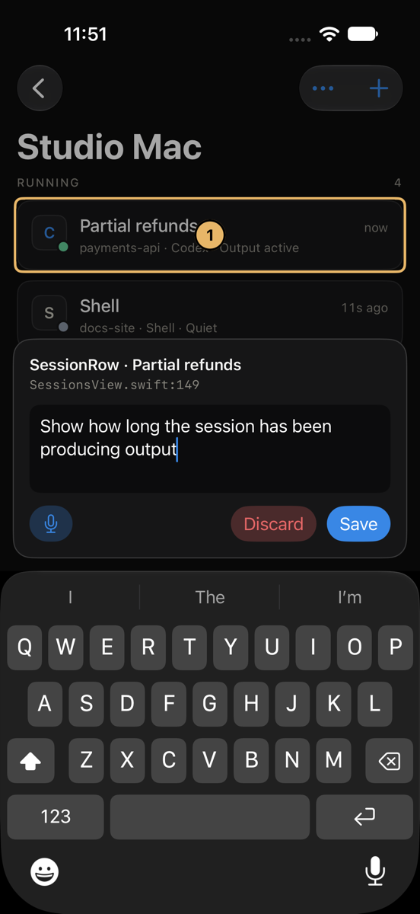
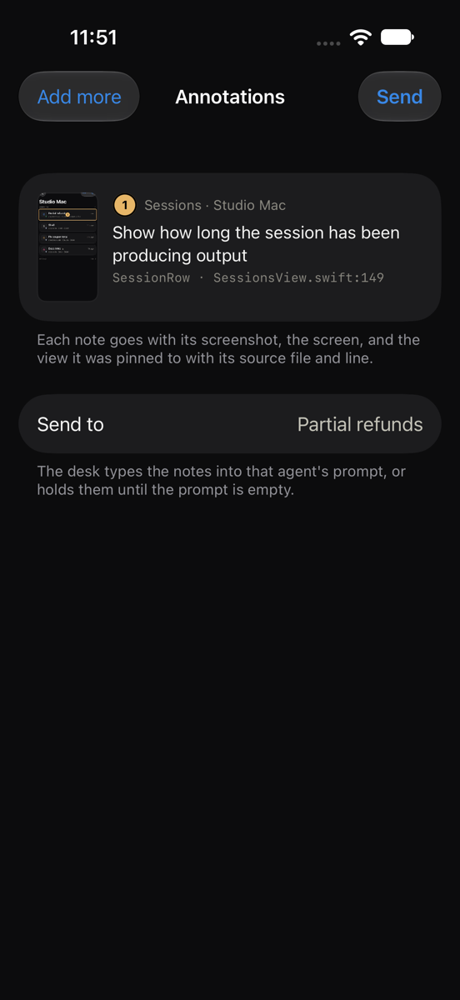

# Agent Desk for iPhone

An iPhone app for the desk running on your Mac or server: see which sessions need you,
answer approval prompts with one tap, type into live terminals, dictate prompts, and launch
agents and coordinators. A Live Activity keeps the desk's state on the Lock Screen and in the
Dynamic Island while the app is connected.

<p>
  
  
  
</p>
<p></p>

Nothing changes for people who do not use it. The desk still listens only on its loopback
address; the phone reaches it the way you would from a laptop, over SSH.

## How it connects

```
iPhone ──SSH──▶ agent-desk mobile info | watch | launch     (JSON over the SSH login)
       ──SSH──▶ mosh-server new -- agent-desk attach <id>    (starts a terminal server)
       ◀─UDP─▶ mosh-server                                   (the live terminal, over Mosh)
```

- **SSH** signs in with a P-256 key the app creates in the iPhone's Secure Enclave. It never
  leaves the phone, and using it takes Face ID or the passcode once each time the app comes
  to the foreground. The server's host key is pinned the first time you connect, after you
  compare its fingerprint, and a changed key stops the connection.
- **Mosh** carries terminals. It survives switching between Wi-Fi and cellular and the
  phone sleeping, because it is UDP with its own encryption and roaming, not a TCP stream.
  `MoshKit` is a Swift implementation of the Mosh protocol written for this app, so the
  project keeps its Apache-2.0 license (Mosh itself is GPLv3). It does not do Mosh's local
  echo prediction.
- **Protected sessions stay at the desk.** The phone signs in as a local helper, so a session
  locked in its pane header is listed with a lock but cannot be opened from the phone.
- **`agent-desk attach <id>`** joins a desk terminal the same way a browser pane does, so the
  phone and the browser see and type into the same session, and the phone's screen size
  becomes the pane's while the phone is attached. Leaving the terminal on the phone stops
  `mosh-server`; the pane keeps running.

## Annotating the app

<p>
  
  
</p>

For working on this app, turn on **Developer → Annotate this app**. A pencil button then floats
over every screen, sheets included. Tap it, tap what should change, and type or dictate what you
want. Each note keeps:

- a screenshot with the pin and the outline of the view it landed on,
- the screen, and the tagged view under the pin: its name, what it shows, and the Swift file and
  line that draws it (from `.annotationTarget(...)` at the call site),
- the point, the display size and scale, appearance and text size, the device and iOS version.

Notes stay on the phone until **Review → Send to** hands them to a Claude, Codex, Grok, OpenCode
or Pi session, or a coordinator; a worker's notes go to its coordinator. The desk decides which
sessions can take them, by the same rule as its browser's annotation picker. They go the way the
desk's own annotation tools send browser feedback: `agent-desk mobile feedback` saves each
screenshot owner-only in the desk's data directory, and the desk's feedback delivery types the
notes into the agent's prompt, or holds them until the prompt is empty. Sending the same notes
again is recognised, not delivered twice.

It works the same in the Simulator on your Mac and on an iPhone, and nothing about it shows until
the toggle is on. To make a new view easy to point at, tag it:

```swift
SessionRow(session: session)
    .annotationTarget("SessionRow", session.name)
```

and mark a sheet's content with `.annotationLayer()` so pins on the sheet never land on the screen
behind it.

## Set up the machine running the desk

1. Make it reachable over SSH. On a Mac, turn on Remote Login in System Settings → General →
   Sharing. [Tailscale](https://tailscale.com) makes it reachable away from home without
   opening ports. Mosh needs UDP ports 60000-61000 reachable too; Tailscale allows them.
2. Install Mosh: `brew install mosh`, or `apt install mosh`.
3. Make sure `agent-desk` runs in a login shell (`ssh you@mac 'zsh -lc "agent-desk mobile info"'`
   should print JSON while the desk is running). If you run Agent Desk from a checkout,
   reinstall it (`pip install -e .`) so the `agent-desk` command has the `attach` and `mobile`
   subcommands, or set the app's command to `python3 -m agent_desk` for that host.
4. In the app, open **This iPhone's key** and add it to `~/.ssh/authorized_keys` on the machine.

## Build and install

Requirements: Xcode (built and tested with Xcode 27 and iOS 18+ deployment), [XcodeGen](https://github.com/yonaskolb/XcodeGen)
(`brew install xcodegen`), and the Metal toolchain (`xcodebuild -downloadComponent MetalToolchain`)
that SwiftTerm's renderer needs.

```sh
cd ios
cp Signing.xcconfig.example Signing.xcconfig   # your team ID and a bundle ID you own
xcodegen generate
open AgentDesk.xcodeproj
```

Choose your iPhone and run. Xcode asks once to trust SwiftTerm's build plugin, which only
writes SwiftTerm's version into the build. With a free Apple ID, apps installed this way
expire after seven days; a paid developer account lasts a year.

## Run it in the Simulator

`ios/dev-desk.sh` runs this checkout's desk on 127.0.0.1:4390 with an sshd on 127.0.0.1:2298
that only takes the keys in `data/ios-dev/sshd/authorized_keys`, so the app logs in to the code
you are changing and never to the desk you work in. The desk keeps its own state in
`data/ios-dev/desk`, starting with a copy of the checkout's accounts. Both stay running until `ios/dev-desk.sh
down`, or a restart; run it again to bring them back.

```sh
ios/dev-desk.sh            # start both and print the settings for the app
cd ios && xcodegen generate && open AgentDesk.xcodeproj
```

Run the **AgentDesk** scheme on an iPhone simulator. Xcode 27 shows simulators in DeviceHub
(Xcode → Open Developer Tool → DeviceHub). Once, in the app: copy **This iPhone's key** into
`data/ios-dev/sshd/authorized_keys`, add a desk with the printed host, user, ports and command
(the last three under **Advanced**), and check the server key it asks you to trust against the
printed one. The app keeps them across launches and
rebuilds.

Changes to `agent_desk/mobile.py` take effect on the app's next request, as the app runs it
fresh each time; changes to the desk's server need `ios/dev-desk.sh down` and `up`.

## Tests

```sh
# The Mosh client against RFC 7253 vectors and the real mosh-server, and the SSH client
# against a throwaway OpenSSH server on a loopback port.
cd ios/AgentDeskKit && swift test

# The whole phone path against a running test desk: SSH, agent-desk mobile, launching a
# pane, Mosh to agent-desk attach, approval detection, detaching and reattaching.
AGENT_DESK_E2E_PORT=4377 AGENT_DESK_E2E_COMMAND=agent-desk swift test --filter DeskEndToEndTests
```

The app's own tests run in the Simulator: `AgentDeskTests` checks approval-menu reading and
transcribes recorded speech with the on-device Whisper model (downloading it once), and
`AgentDeskUITests` drives the app through setup, an approval, typing, an agent and a coordinator
launch and the Live Activity against a fixture desk. The UI test needs a desk and an sshd to
talk to, passed in `TEST_RUNNER_E2E_*` variables: `E2E_SSH_PORT`, `E2E_DESK_PORT`, `E2E_USER`,
`E2E_COMMAND`, `E2E_AUTHORIZED_KEYS` (a file the sshd reads, which the test writes the app's key
into), `E2E_FINGERPRINT` (the sshd's host key fingerprint) and, optionally, `E2E_SHOTS` for
screenshots. Never point tests at the desk you work in.

## Limits

- No push notifications yet: the session list and Live Activity update while the app is
  connected, and the Live Activity shows when it was last updated once iOS suspends the app.
- Terminals on remote desk nodes (`remote:` panes) are polled through the desk, as in the
  browser, so they are a little less immediate than local ones.
- Mosh has no scrollback of its own; the terminal keeps what scrolls by while it is open.
